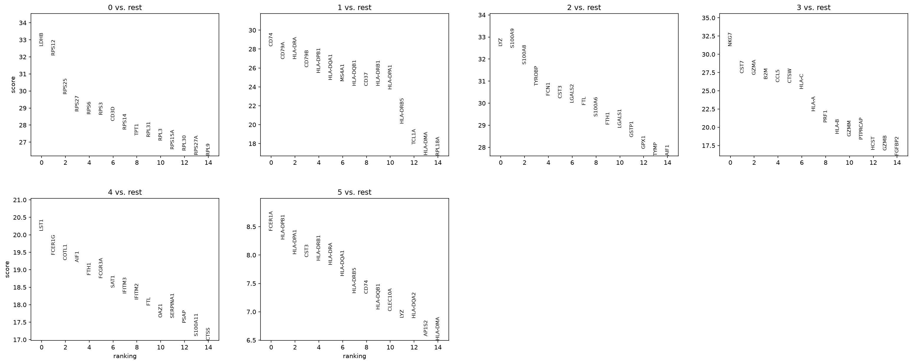
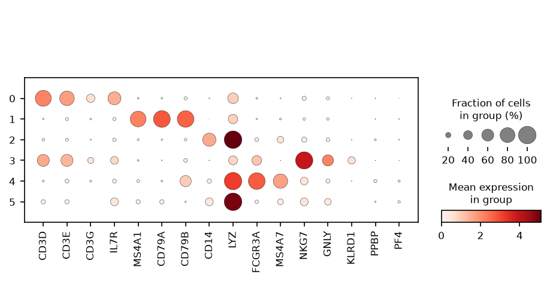
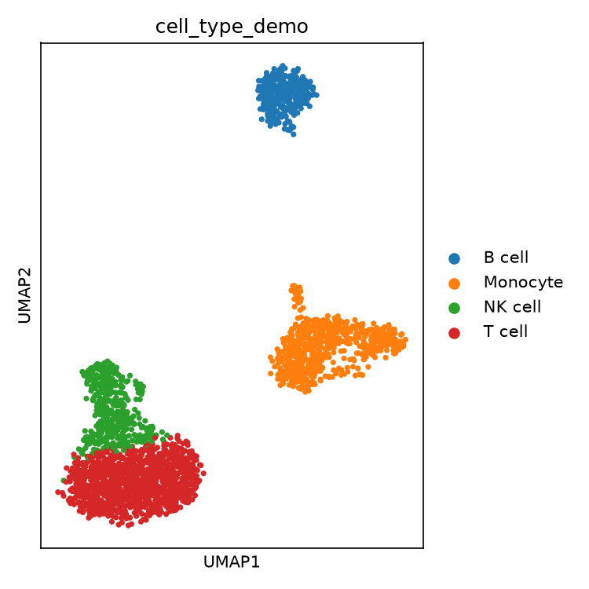
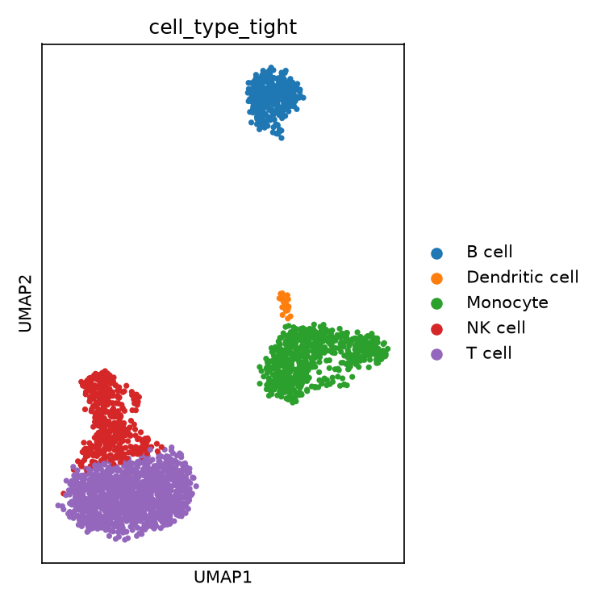

# Markers and annotation — why marker specificity decides everything

Marker detection compared across two statistical tests, and an annotation
experiment that shows plainly how annotation quality depends on how *specific*
the markers are, not just whether they are relevant.

**Data:** PBMC3k, clustered at resolution 0.6 (6 clusters). This report used
the original annotator, `scripts/04_markers_annotation.py`; the lessons here
and on [real data](real-data-validation.md#annotation-at-scale) led to the
confidence-gated `04b_better_annotation.py` used in the pipeline today.

---

## Method

1. **Marker detection:** Wilcoxon rank-sum test, each cluster against all
   others (scanpy's equivalent of Seurat's default `FindMarkers` test).
2. **Annotation:** a small dictionary of canonical markers is scored per cell,
   averaged per cluster, and each cluster gets its highest-scoring label. The
   dictionary is blood-specific by design.

---

## Results on PBMC3k

*Each panel is unambiguous: T-cell/ribosomal, B-cell, monocyte, NK/cytotoxic, a
second monocyte-like signature, and a mixed myeloid/MHC-II signature.*

*Dot size = fraction of cells expressing; colour = mean expression. Each marker
set lights up in exactly the cluster it should.*

---

## Wilcoxon vs. t-test

Same clusters, top 10 genes per cluster from each test:

| Cluster | Wilcoxon top 5 | t-test top 5 | Shared (of 10) |
|---|---|---|---|
| 0 (T cell) | LDHB, RPS12, RPS25, RPS27, RPS6 | LDHB, CD3D, RPS12, RPS25, RPS27 | 7 |
| 1 (B cell) | CD74, CD79A, HLA-DRA, CD79B, HLA-DPB1 | CD74, HLA-DRA, HLA-DPB1, HLA-DRB1, CD79A | 9 |
| 2 (monocyte) | LYZ, S100A9, S100A8, TYROBP, FCN1 | LYZ, CST3, TYROBP, FTL, S100A9 | 8 |
| 3 (NK cell) | NKG7, CST7, GZMA, B2M, CCL5 | NKG7, CST7, GZMA, B2M, CCL5 | 9 |
| 4 (FCGR3A+ monocyte) | LST1, FCER1G, COTL1, AIF1, FTH1 | FTH1, FTL, LST1, AIF1, CST3 | 7 |
| 5 (dendritic cell) | FCER1A, HLA-DPB1, HLA-DPA1, CST3, HLA-DRB1 | CST3, LYZ, HLA-DRA, HLA-DPB1, HLA-DPA1 | 6 |

Average overlap **7.7 of 10**. The tests agree on the identity-defining genes
(the top one or two are nearly always shared) and differ on secondary genes,
most in cluster 5, where two nearby myeloid populations share much biology.

> **Takeaway:** Wilcoxon does not assume normally distributed values, which
> single-cell counts are not. Either test supports the same conclusions here;
> Wilcoxon is the more defensible default.

---

## Annotation: a real failure, then a real fix

### Attempt 1 — add a dendritic-cell category with broad markers

Cluster 5's top genes (FCER1A, CST3, HLA-DPB1, HLA-DPA1) are a textbook
dendritic-cell signature, but the demo dictionary had no DC category, so
cluster 5 was absorbed into "Monocyte". Adding DC with those four genes looked
like the obvious fix:

| Cluster | Label with broad DC markers |
|---|---|
| 0 | T cell — correct |
| 1 | B cell — correct |
| 2 | **Dendritic cell — wrong, this is CD14+ monocyte** |
| 3 | NK cell — correct |
| 4 | **Dendritic cell — wrong, this is FCGR3A+ monocyte** |
| 5 | Dendritic cell — correct |

**What went wrong:** CST3, HLA-DPB1 and HLA-DPA1 are not DC-specific — all
antigen-presenting myeloid cells express them, monocytes included. The DC
score rose in *every* myeloid cluster and stole two monocyte clusters that were
correct before.

### Attempt 2 — tighten the markers

DC markers reduced to `FCER1A` and `CLEC10A` (more specific to blood
conventional DCs), monocyte set strengthened with S100A8/S100A9:

| Cluster | Label with tight DC markers |
|---|---|
| 0 | T cell — correct |
| 1 | B cell — correct |
| 2 | Monocyte — correct |
| 3 | NK cell — correct |
| 4 | Monocyte — correct |
| 5 | Dendritic cell — correct |

| Original 5 categories (DC absorbed into monocyte) | Tight 6 categories (all six resolve) |
|---|---|
|  |  |

> **Key result:** marker-score annotation is only as good as marker
> *specificity*. Genes that genuinely mark a cell type but are also expressed
> elsewhere can make annotation actively worse by contaminating neighbouring
> populations' scores. The same caution applies to reference-based and
> foundation-model annotation [8].

---

## Caveats

- **Marker sets are tissue-specific.** Real data from another tissue needs its
  own set, built the same way: broad, then tightened against the actual top
  marker genes.
- **This is not reference-based annotation** (label transfer, scANVI). Those
  methods handle specificity better, but the lesson still applies.

---

References: [3] OSCA, marker-detection chapter; [4] Hao et al. 2021; [8] Khan
et al. 2023 — full entries in [design decisions](design-decisions.md#references).
Code: [`scripts/04_markers_annotation.py`](../../scripts/04_markers_annotation.py),
[`scripts/04b_better_annotation.py`](../../scripts/04b_better_annotation.py) ·
Previous: [Clustering](clustering.md) · Next: [Real-data validation](real-data-validation.md)
