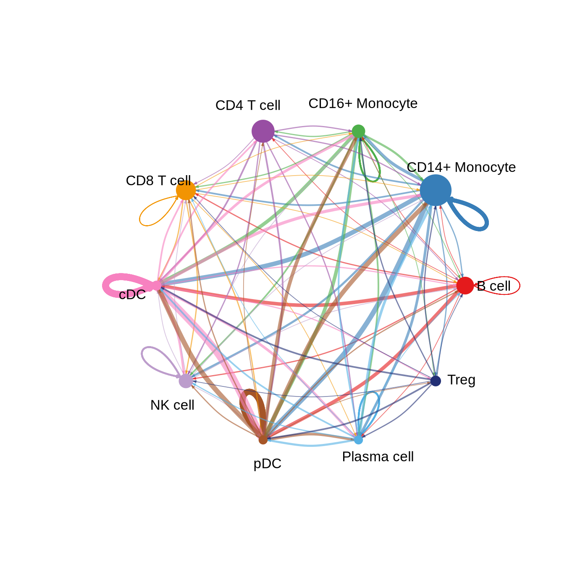
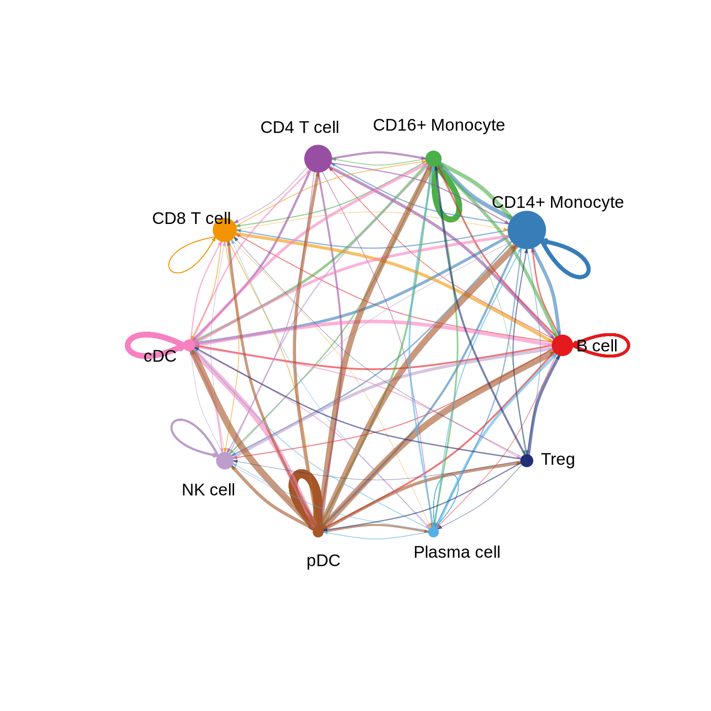
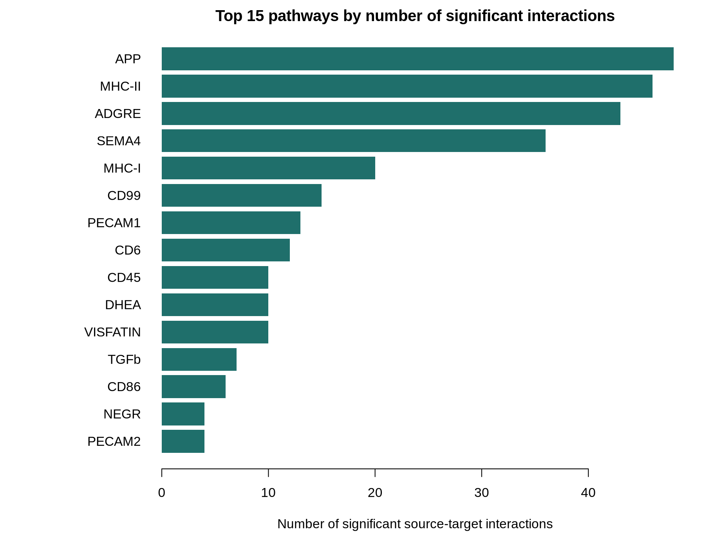
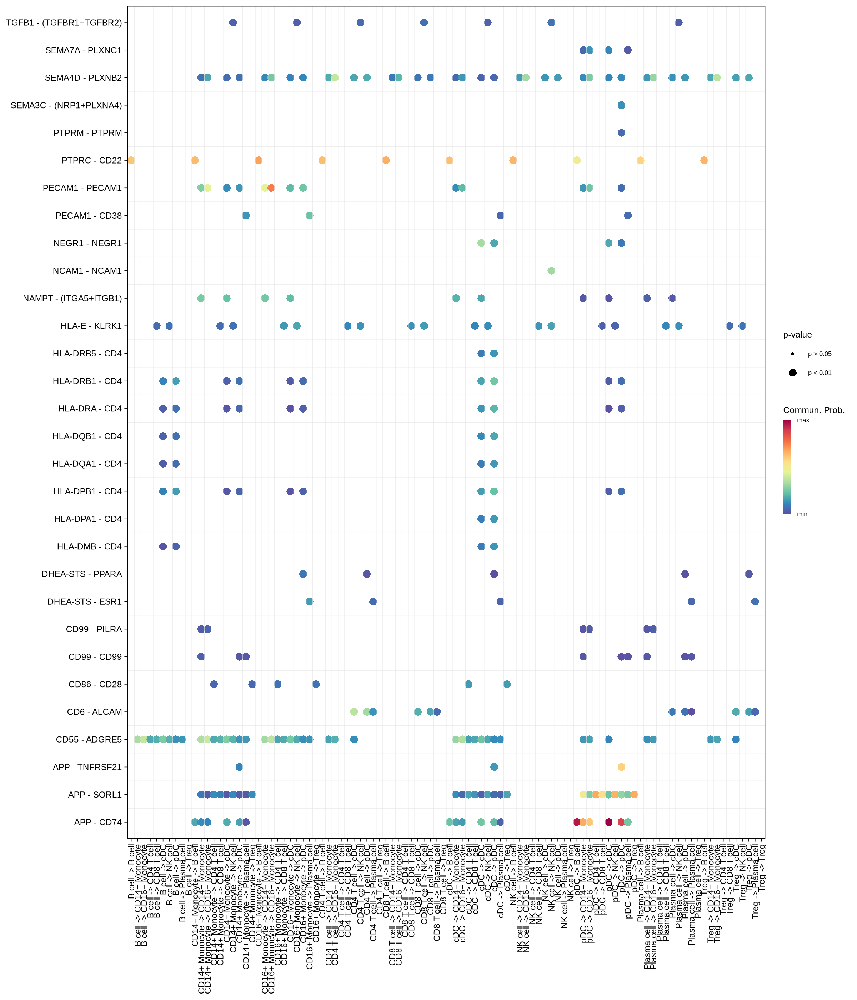

# Cell-cell communication — CellChat results, and what its permutation test adds

What CellChat infers, its results on the full real dataset, and a computed
comparison against a naive baseline that skips the permutation test.

**Data:** the real Parse 1M PBMC run — 907,696 cells after QC → Harmony →
clustering → 04b annotation; 212,893 `Ambiguous` cells excluded, leaving
**694,803 confidently labelled cells across 10 cell types**.

---

## What CellChat infers

There is no direct measurement of signalling in scRNA-seq; every
"interaction" is a statistical inference [11]. For each ligand-receptor pair in
CellChat's curated database (including multi-subunit receptors such as
`TGFBR1+TGFBR2`) and each ordered pair of cell types (source → target,
including a type signalling to itself), CellChat computes a **communication
probability** from the ligand's average expression in the source and the
receptor's in the target. It then tests it by **permutation**: cell-type labels
are shuffled many times, the probability recomputed each time, and the real
value compared with that random distribution to get a p-value.

Only confidently labelled cells are passed in (`--exclude-ambiguous`): feeding
an uncertain label into a communication test would only turn the uncertainty
into a false-looking signal.

---

## Results

**291 significant interactions across 19 signalling pathways** (p < 0.05),
in about 1.5 hours — almost all of it the permutation step, by far the
slowest stage of the pipeline at this cell count.

| Number of interactions | Interaction strength |
|---|---|
|  |  |

*Left: edge thickness = number of interactions; node size = cell-type
abundance. Right: summed probability — a pair can have few strong
interactions or many weak ones.*

| Pathway | Significant interactions |
|---|---|
| APP | 48 |
| MHC-II | 46 |
| ADGRE | 43 |
| SEMA4 | 36 |
| MHC-I | 20 |
| CD99 | 15 |
| PECAM1 | 13 |
| CD6 | 12 |
| VISFATIN | 10 |
| DHEA | 10 |

This is what the data produced, not a fixed panel. It is biologically sensible
— MHC-I and MHC-II are the antigen-presentation pathways expected to dominate
blood with many antigen-presenting myeloid cells — but plausibility is a sanity
check, not validation.

| Cell type | As sender | As receiver |
|---|---|---|
| cDC | 59 | 59 |
| pDC | 51 | 64 |
| CD14+ monocyte | 52 | 39 |
| CD16+ monocyte | 33 | 31 |
| plasma cell | 22 | 27 |
| B cell | 23 | 13 |
| NK cell | 9 | 25 |
| CD4 T cell | 16 | 10 |
| Treg | 15 | 6 |
| CD8 T cell | 11 | 17 |

Myeloid cells (cDC, pDC, both monocyte types) are the most frequent senders and
receivers by a wide margin, and cDC↔pDC is the single most cross-talking pair
(15 interactions cDC→pDC, 10 pDC→cDC).

*Every significant interaction: source → target on the x-axis, ligand-receptor
pair on the y-axis. Scan this first when looking for a specific pathway.*

---

## Does the permutation test matter? A computed comparison

Would ranking every tested pair by raw probability and keeping the top N give
the same answer? CellChat already stores the probability (`net$prob`) and the
permutation p-value (`net$pval`) for *every* tested combination, so both arms
come from the same object, with no re-implementation.

**Naive baseline:** the top 291 by raw probability, no test at all.

| Quantity | Count |
|---|---|
| tested (source, target, pair) combinations with probability > 0 | 315 |
| significant by permutation (p < 0.05) | 291 |
| naive top 291 that are also significant | 267 (91.8%) |
| naive only: high probability, rejected by the permutation test | 24 |
| significant only: missed by the naive ranking | 24 |

> **The two mostly agree.** 91.8% overlap: the permutation test does not
> reverse the naive answer, it corrects its edges. That is a different, more
> modest claim than "the naive method is useless".

Where it earns its cost:

- **24 naive-only pairs** had high probability but were indistinguishable from
  random relabelling. 13 of them are one pair, `CD55_ADGRE5`, between T, NK,
  Treg, pDC and plasma cells — permutation p = 1, pure chance despite a
  respectable raw score.
- **24 significant-only pairs** were confirmed despite a modest probability —
  most likely in large, low-variance groups where even a small effect is
  reliably non-random.

| Source | Target | Pair | Probability | Permutation p |
|---|---|---|---|---|
| plasma cell | cDC | CD55_ADGRE5 | 0.0129 | 0.12 |
| CD4 T cell | NK cell | CD55_ADGRE5 | 0.0115 | 1.00 |
| CD4 T cell | CD8 T cell | CD55_ADGRE5 | 0.0113 | 1.00 |
| CD4 T cell | CD4 T cell | CD55_ADGRE5 | 0.0101 | 1.00 |
| pDC | cDC | PECAM1_PECAM1 | 0.0071 | 0.14 |

| Group | Median probability |
|---|---|
| significant pairs | 0.0203 |
| non-significant pairs | 0.00757 |

Significant pairs have ~2.7× the median probability (Wilcoxon rank-sum,
W = 5291, p = 2.7 × 10⁻⁵) — a real relationship, but a tendency, not a rule,
which is why naive ranking mislabels 48 of 315 pairs.

**Why they diverge.** The permutation test implicitly accounts for **group size
and variance**, which raw probability ignores. A small group (pDC and plasma
cells are the two smallest, 4,207 and 3,387 of 694,803 cells) can give a
confident-looking probability from a handful of high-expressing cells; the
same magnitude in a large, noisy group means much less. That is exactly the
`CD55_ADGRE5` pattern. The reverse — modest but confirmed — is the same
mechanism in a large, stable group.

---

## Caveats

- **Inference, not observation.** Treat strong hits as hypotheses.
- **No donor structure.** All 24 donors were one pooled population (CellChat
  warned that metadata had no sample column), so donor- or disease-specific
  signalling cannot be seen yet.
- **Excluded cells are invisible.** The 212,893 `Ambiguous` cells are absent.
- **Finite database.** A missing pathway may be missing from CellChat's
  database rather than from the biology; see the broader survey [12].
- **One time point.**

---

References: [11] Jin et al. 2021; [12] Peng et al. 2022 — full entries in
[design decisions](design-decisions.md#references).
Code: [`scripts/06_export_for_cellchat.py`](../../scripts/06_export_for_cellchat.py),
[`scripts/07_cellchat_analysis.R`](../../scripts/07_cellchat_analysis.R) ·
Previous: [Real-data validation](real-data-validation.md) · Next: [Trajectory design](trajectory-design.md)
