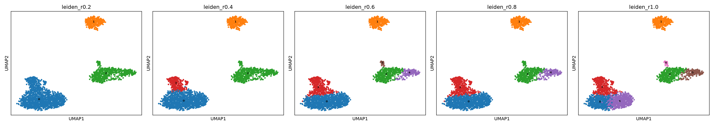
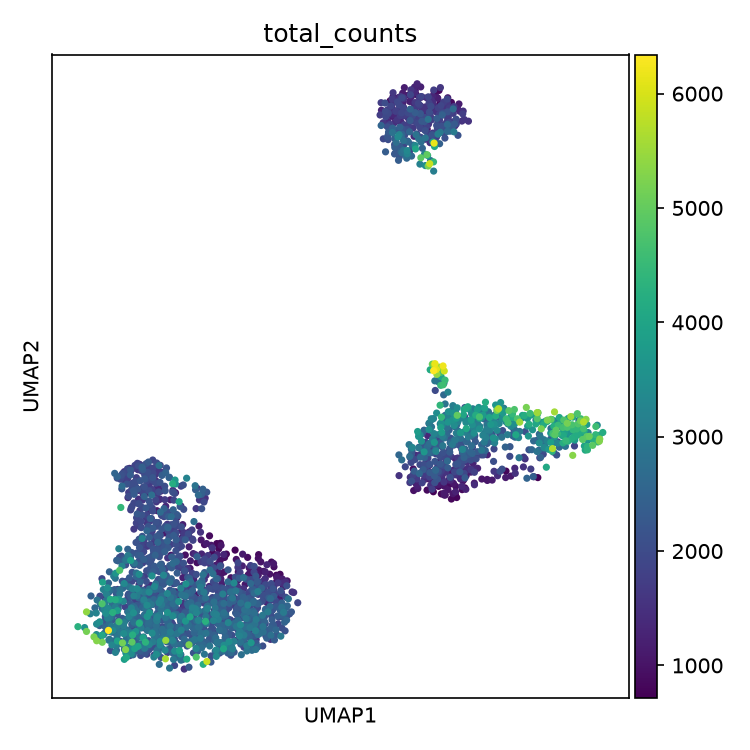

# Clustering — Leiden vs. Louvain

What `scripts/03_cluster.py` does, with a computed comparison against
Louvain — the algorithm Leiden was designed to replace — on the same graph.

**Data:** PBMC3k after QC and PCA.

---

## Method

1. **Neighbour graph** on the 50 principal components (not raw genes).
2. **Leiden clustering at five resolutions** (0.2, 0.4, 0.6, 0.8, 1.0), each
   saved to its own column, so a resolution is chosen after looking at the
   data rather than up front.
3. **UMAP**, for viewing only — nothing downstream reads it.

---

## Results on PBMC3k

| Resolution | Clusters |
|---|---|
| 0.2 | 3 |
| 0.4 | 4 |
| 0.6 | 6 |
| 0.8 | 5 |
| 1.0 | 7 |

The count is not strictly rising with resolution (6 at 0.6, then 5 at 0.8):
Leiden's local optimisation can merge or split differently at nearby
resolutions. That is normal — and why the script scans a range.

*The three-lineage shape is stable at every resolution; only how finely each
island is subdivided changes.*

*A smooth gradient within islands, and no cluster boundary that follows a
depth boundary.*

---

## Comparison: Leiden vs. Louvain

Leiden was published to fix a defect in Louvain, which can produce badly
connected or even internally disconnected communities; Leiden guarantees it
does not [Traag et al.]. Both were run on the identical graph at each
resolution and compared with the Adjusted Rand Index (ARI: 1.0 = identical
partitions, 0 = no better than random):

| Resolution | Leiden clusters | Louvain clusters | ARI |
|---|---|---|---|
| 0.2 | 3 | 3 | 0.9994 |
| 0.4 | 4 | 4 | 0.8971 |
| 0.6 | 6 | 4 | 0.8978 |
| 0.8 | 5 | 5 | 0.9458 |
| 1.0 | 7 | 7 | 0.8805 |

> **Key result:** ARI never drops below 0.88; the two agree on the large-scale
> structure everywhere. The one difference in cluster *count* (0.6: 6 vs. 4)
> is most likely the CD14+ vs. FCGR3A+ monocyte split — a known borderline case
> in this dataset — which Leiden separates and Louvain keeps merged.

**Why.** Both optimise a similar objective on the same graph, but Louvain's
local moves can leave a community only weakly connected inside. Leiden adds a
refinement phase that guarantees well-connected communities — exactly where
the two can land on different counts for genuinely borderline populations.

---

## Caveats

- **An easy case.** PBMC3k has a few well-separated lineages. Real Parse data
  at scale is harder: 9–22 clusters on the real data (see
  [real-data validation](real-data-validation.md)).
- **No "correct" cluster count exists** for PBMC3k (published analyses range
  from ~6 to 10+), so this compares algorithms with each other, not with an
  invented right answer.

---

References: [3] OSCA, clustering chapter ([design decisions](design-decisions.md#references));
Traag VA, Waltman L, van Eck NJ. From Louvain to Leiden: guaranteeing
well-connected communities. *Scientific Reports*. 2019;9:5233.
[doi:10.1038/s41598-019-41695-z](https://doi.org/10.1038/s41598-019-41695-z).
Code: [`scripts/03_cluster.py`](../../scripts/03_cluster.py) ·
Previous: [Normalization, HVG, PCA](normalization-pca.md) · Next: [Markers and annotation](annotation.md)
