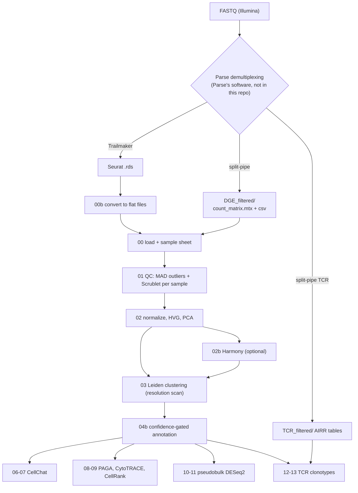

# Design decisions

Scope, the pipeline as built, the decisions behind it, what each QC metric
catches, and where the pipeline could go next. References are numbered at the
bottom of this page; the other reference pages reuse these numbers.

---

## Scope

Raw data comes off an Illumina sequencer as FASTQ files from a Parse Evercode
library (or as raw BCL files, converted with `bcl2fastq --no-lane-splitting`
and **no** adapter-trimming sequence set — Parse warns trimming can cut into
the barcode region of read 2). Parse's split-pool chemistry encodes each cell's
identity as a combination of barcodes across three rounds, inside the reads,
so generic demultiplexers (bcl2fastq alone, Cell Ranger) cannot assign reads to
cells. That step must go through Parse's own software — Trailmaker (cloud) or
split-pipe (command line) [5]. Everything after that hand-off is this
pipeline.

- **Assays:** whole transcriptome (WT) first, validated end to end on real
  data. Evercode TCR is handled by a separate clonotype module (scripts
  12–13), tested on synthetic data so far.
- **Species:** human, mouse and dog marker sets for annotation (mouse and dog
  not yet validated on real non-human data).
- **Compute:** an HPC cluster with SLURM (built on UF HiPerGator), each step
  sized to the smallest allocation that finishes in reasonable time; no GPU.

---

## The pipeline as built

Python (scanpy) runs the whole chain. R is used only where it is the best
tool: CellChat, DESeq2, and reading Trailmaker's Seurat export. Python and R
exchange flat files (matrix + CSV), not a live bridge.

---

## The decisions behind it

The first four decisions were made before any code was written. Building and
testing on real data changed one of them.

| Question | Options considered | Chosen at the start | What was built, and why |
|---|---|---|---|
| Which analysis stack? | Python only · Python QC + R/Seurat downstream · R only | Python QC + R/Seurat downstream | **Python end to end, R only for CellChat and DESeq2.** The planned Python→R hand-off tool (zellkonverter) failed to install on the cluster (it tried to compile Python from source), and a flat-file exchange proved simpler and robust |
| How to scope the repository? | inside an existing repo · dedicated repo | dedicated repo | as chosen |
| How to use the HPC? | design locally first · connect now | connect now, logging in interactively | as chosen; every heavy step runs as a SLURM job |
| Include TCR from the start? | WT + TCR together · WT first | WT first | WT validated first; TCR module added after (scripts 12–13) |

Later decisions, each made when real data or testing forced it:

| Decision | Why |
|---|---|
| doublet detection per sample, not pooled | correct for Scrublet's model [23], and the pooled run ran out of memory at 400 GB |
| a confidence-gated annotator (04b) | the simple one confidently mislabelled clusters on real data |
| Harmony pinned to `harmonypy` 0.0.10 | 2.0.0 corrupted its output on 907,696 cells |
| CellChat with 1 worker | more workers multiplied memory instead of saving time |
| CellRank in a separate Python 3.12 environment | it cannot install into the validated Python 3.11 one |
| sublibrary as the batch for split-pipe data | every sublibrary holds every sample, so sublibrary is the technical batch |
| DE design chosen at run time | different experiments (unpaired, paired, batched) need different models |
| split-pipe not distributed | Parse's licensed software; only what the pipeline expects from its output is documented |

---

## Why Parse's demultiplexer is required

Parse's chemistry is a commercial form of split-pool combinatorial barcoding:
cells (or fixed nuclei) are spread across a plate, barcoded, pooled and re-split
over several rounds, so each cell is identified by a *combination* of barcodes
read from inside the cDNA read, not by one index read [5]. That is what makes it
scale without microfluidics — and why the barcode-to-cell assignment is
specific to the chemistry. This pipeline treats Parse's step as a fixed,
versioned upstream stage and starts at the count matrix.

**Trailmaker vs. split-pipe.** Both run the same barcode correction, alignment
and counting. Trailmaker is Parse's hosted, no-code front end; split-pipe is
the command-line version, the route where data never leaves the cluster.
split-pipe is Parse's licensed software (available from Parse's
[Pipeline Download Request Form](https://www.parsebiosciences.com/pipeline-download/));
none of its code is distributed here.

---

## What each QC metric catches

Thresholds adapt to each dataset (median ± *k* median absolute deviations),
following OSCA [3] and SCTK-QC [1], because "normal" values shift with cell
type, tissue and chemistry.

| Metric | Measures | Why it matters biologically |
|---|---|---|
| total counts per cell | sequencing depth / RNA captured | too low usually means a degraded cell — but a fixed cutoff also throws away genuinely small, quiet cells (e.g. naive lymphocytes); an adaptive threshold does not |
| genes detected per cell | transcriptome complexity | very low tracks empty barcodes; unusually high for the depth is a classic doublet signature |
| mitochondrial read % | share of reads from mitochondrial genes | rises when cytoplasmic RNA leaks through a damaged membrane — stressed or dying cells. Baseline varies by cell type, so it is exactly the kind of metric adaptive thresholds are for |
| doublet score | chance a barcode holds more than one cell | in split-pool chemistry, two cells that by chance receive the same barcode combination — the rate grows with cells per sublibrary, so droplet-platform assumptions do not transfer directly |
| ambient RNA | RNA from lysed cells re-captured by other barcodes | arises during shared pooling/ligation rather than inside a droplet; the concern (diluted cell identity) and decontamination ideas still apply |
| empty barcodes | combinations indistinguishable from noise | the split-pool version of empty droplets; separated from real cells statistically before per-cell metrics [1, 2] |

---

## Roadmap: implemented, and possible next layers

| # | Stage | Status |
|---|---|---|
| 1 | normalization | log-normalization (per 10k, log1p); Pearson-residual methods only if overdispersion becomes a real problem |
| 2 | feature selection, PCA | seurat_v3 HVGs → PCA [3]. If labelled cells exist for part of a run, CellMentor's supervised, cell-type-aware NMF is an alternative that separates close types better [9] |
| 3 | batch correction | **implemented, validated** — Harmony [24]; converged in 6 iterations on 24 donors / 907,696 cells |
| 4 | clustering | Leiden with a resolution scan. At hundreds of thousands of cells, scHashFormer reports up to ~100× faster clustering [6] — only if runtime becomes a problem |
| 5 | markers and annotation | Wilcoxon markers + confidence-gated marker scoring (04b) |
| 6 | pseudobulk DE, volcano, heatmap | **implemented** — pseudobulk aggregation then DESeq2 [20], per cell type, controls false discoveries better than per-cell tests [7]. Design (unpaired, paired, batch) chosen at run time; tested on synthetic data |
| 7 | transformer / foundation-model annotation | **flagged, not adopted** — performance is highly sensitive to cell-type imbalance in training data [8] |
| 8 | cell-type-specific co-expression | optional, only for a specific regulatory question [10] |
| 9 | cell-cell communication | **implemented, validated** — CellChat [11]: 291 interactions, 19 pathways on 694,803 cells. A broader method/database survey [12] helps if CellChat's database lacks a pathway |
| 10 | trajectories and fate mapping | **implemented, not yet run** — PAGA [14] + CytoTRACE [15] + CellRank 2 [18]. True RNA velocity [16, 17] needs spliced/unspliced counts, which standard Parse output lacks. A bone-marrow-to-tumour trajectory needs both tissues actually sampled; pan-cancer myeloid work is prior art for the expected biology [19] |
| 11 | TCR / VDJ | **implemented, tested on synthetic split-pipe-format data** — scirpy [21]: clonotypes from TRA+TRB CDR3 amino acids, rarefied diversity, sharing across samples and patients, expanded-clone phenotypes. A joint GEX+TCR model such as TRIM [13] is a possible later layer |

---

## References

1. Hong R, Koga Y, Bandyadka S, et al. Comprehensive generation, visualization, and reporting of quality control metrics for single-cell RNA sequencing data. *Nature Communications*. 2022;13:1688. [doi:10.1038/s41467-022-29212-9](https://doi.org/10.1038/s41467-022-29212-9)
2. Gao Y, He D, Patro R. QCatch: a framework for quality control assessment and analysis of single-cell sequencing data. *Bioinformatics*. 2026;42(5):btag184. [doi:10.1093/bioinformatics/btag184](https://doi.org/10.1093/bioinformatics/btag184)
3. Amezquita RA, Lun ATL, Hicks SC, Gottardo R. *Orchestrating Single-Cell Analysis with Bioconductor* — Basics, v1.0.0. Bioconductor, 2021. (Online book, not a peer-reviewed article.)
4. Hao Y, Hao S, Andersen-Nissen E, et al. Integrated analysis of multimodal single-cell data. *Cell*. 2021;184(13):3573–3587.e29. [doi:10.1016/j.cell.2021.04.048](https://doi.org/10.1016/j.cell.2021.04.048) (Seurat v4/5)
5. Rosenberg AB, Roco CM, Muscat RA, et al. Single-cell profiling of the developing mouse brain and spinal cord with split-pool barcoding. *Science*. 2018;360(6385):176–182. [doi:10.1126/science.aam8999](https://doi.org/10.1126/science.aam8999) (SPLiT-seq, the basis of Parse Evercode)
6. Lu Z, Bai L, Li L, Yang X, Liang J. scHashFormer: a hash-driven graph transformer for scalable scRNA-seq clustering. *Briefings in Bioinformatics*. 2026;27(4):bbag402. [doi:10.1093/bib/bbag402](https://doi.org/10.1093/bib/bbag402)
7. Murphy AE, Skene NG. A balanced measure shows superior performance of pseudobulk methods in single-cell RNA-sequencing analysis. *Nature Communications*. 2022;13:7851. [doi:10.1038/s41467-022-35519-4](https://doi.org/10.1038/s41467-022-35519-4)
8. Khan SA, Maillo A, Lagani V, et al. Reusability report: Learning the transcriptional grammar in single-cell RNA-sequencing data using transformers. *Nature Machine Intelligence*. 2023;5(12):1437–1446. [doi:10.1038/s42256-023-00757-8](https://doi.org/10.1038/s42256-023-00757-8)
9. Hevdeli O, Petrenko E, Aran D. CellMentor: cell-type aware dimensionality reduction for single-cell RNA-sequencing data. *Nature Communications*. 2025;17:396. [doi:10.1038/s41467-025-67088-7](https://doi.org/10.1038/s41467-025-67088-7)
10. Su C, Xu Z, Shan X, et al. Cell-type-specific co-expression inference from single cell RNA-sequencing data. *Nature Communications*. 2023;14. [doi:10.1038/s41467-023-40503-7](https://doi.org/10.1038/s41467-023-40503-7)
11. Jin S, Guerrero-Juarez CF, Zhang L, et al. Inference and analysis of cell-cell communication using CellChat. *Nature Communications*. 2021;12:1088. [doi:10.1038/s41467-021-21246-9](https://doi.org/10.1038/s41467-021-21246-9) · code: [github.com/jinworks/CellChat](https://github.com/jinworks/CellChat)
12. Peng L, Wang F, Wang Z, et al. Cell–cell communication inference and analysis in the tumour microenvironments from single-cell transcriptomics: data resources and computational strategies. *Briefings in Bioinformatics*. 2022;23(4):bbac234. [doi:10.1093/bib/bbac234](https://doi.org/10.1093/bib/bbac234)
13. He C, Amodio M, Ashenberg O, et al. Multimodal framework for the joint analysis of single-cell RNA and T cell receptor sequencing data predicts T cell response to cancer immunotherapy. *Nature Communications*. 2026;17:3840. [doi:10.1038/s41467-026-70505-0](https://doi.org/10.1038/s41467-026-70505-0)
14. Wolf FA, Hamey FK, Plass M, et al. PAGA: graph abstraction reconciles clustering with trajectory inference through a topology preserving map of single cells. *Genome Biology*. 2019;20:59. [doi:10.1186/s13059-019-1663-x](https://doi.org/10.1186/s13059-019-1663-x)
15. Gulati GS, Sikandar SS, Wesche DJ, et al. Single-cell transcriptional diversity is a hallmark of developmental potential. *Science*. 2020;367(6476):405–411. [doi:10.1126/science.aax0249](https://doi.org/10.1126/science.aax0249)
16. La Manno G, Soldatov R, Zeisel A, et al. RNA velocity of single cells. *Nature*. 2018;560(7719):494–498. [doi:10.1038/s41586-018-0414-6](https://doi.org/10.1038/s41586-018-0414-6)
17. Bergen V, Lange M, Peidli S, Wolf FA, Theis FJ. Generalizing RNA velocity to transient cell states through dynamical modeling. *Nature Biotechnology*. 2020;38:1408–1414. [doi:10.1038/s41587-020-0591-3](https://doi.org/10.1038/s41587-020-0591-3) (scVelo)
18. Weiler P, Lange M, Klein M, Pe'er D, Theis F. CellRank 2: unified fate mapping in multiview single-cell data. *Nature Methods*. 2024;21:1196–1205. [doi:10.1038/s41592-024-02303-9](https://doi.org/10.1038/s41592-024-02303-9)
19. Cheng S, Li Z, Gao R, et al. A pan-cancer single-cell transcriptional atlas of tumor infiltrating myeloid cells. *Cell*. 2021;184(3):792–809.e23. [doi:10.1016/j.cell.2021.01.010](https://doi.org/10.1016/j.cell.2021.01.010)
20. Love MI, Huber W, Anders S. Moderated estimation of fold change and dispersion for RNA-seq data with DESeq2. *Genome Biology*. 2014;15:550. [doi:10.1186/s13059-014-0550-8](https://doi.org/10.1186/s13059-014-0550-8)
21. Sturm G, Szabo T, Fotakis G, et al. Scirpy: a Scanpy extension for analyzing single-cell T-cell receptor-sequencing data. *Bioinformatics*. 2020;36(18):4817–4818. [doi:10.1093/bioinformatics/btaa611](https://doi.org/10.1093/bioinformatics/btaa611)

22. Wolf FA, Angerer P, Theis FJ. SCANPY: large-scale single-cell gene expression data analysis. *Genome Biology*. 2018;19:15. [doi:10.1186/s13059-017-1382-0](https://doi.org/10.1186/s13059-017-1382-0)
23. Wolock SL, Lopez R, Klein AM. Scrublet: computational identification of cell doublets in single-cell transcriptomic data. *Cell Systems*. 2019;8(4):281–291.e9. [doi:10.1016/j.cels.2018.11.005](https://doi.org/10.1016/j.cels.2018.11.005)
24. Korsunsky I, Millard N, Fan J, et al. Fast, sensitive and accurate integration of single-cell data with Harmony. *Nature Methods*. 2019;16(12):1289–1296. [doi:10.1038/s41592-019-0619-0](https://doi.org/10.1038/s41592-019-0619-0)

Vendor documentation (not peer-reviewed), cited for platform workflow detail only: Parse Biosciences, Trailmaker user guide and data-analysis documentation.
