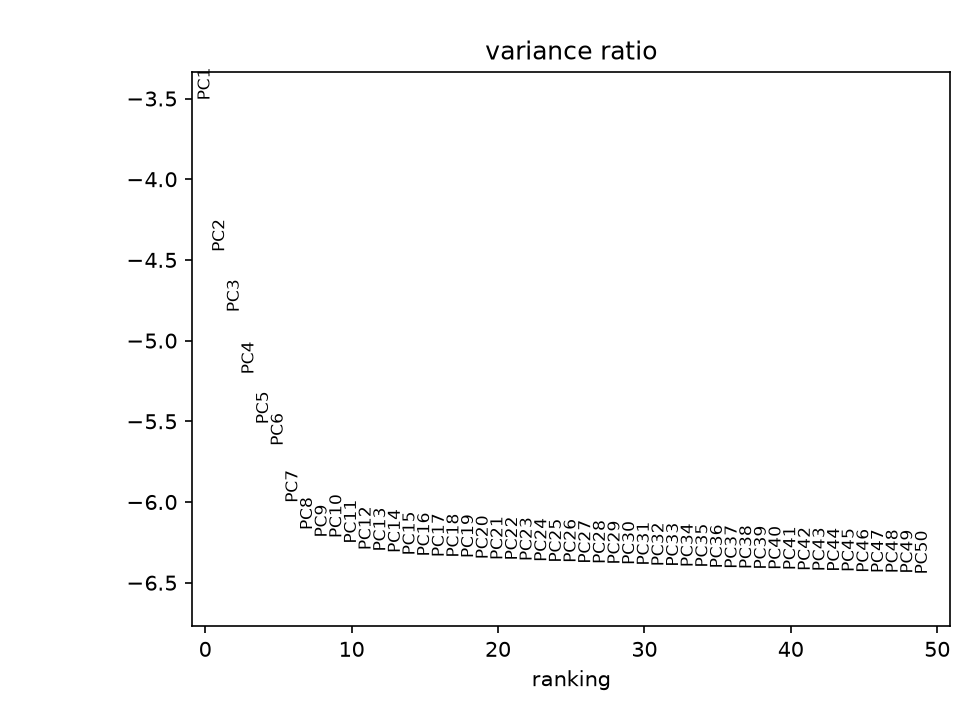
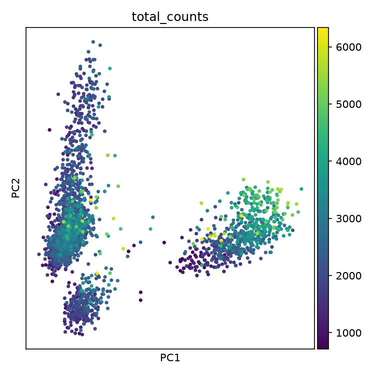

# Normalization, highly variable genes and PCA

What `scripts/02_normalize_pca.py` does, with a computed comparison of two
ways of choosing the highly variable genes, on the same cells.

**Data:** PBMC3k after QC (2,526 cells × 13,714 genes).

---

## Method

1. **Normalize:** each cell rescaled to 10,000 total counts, then `log1p`.
   Raw counts are kept in `adata.layers["counts"]` and the normalized,
   unscaled matrix in `adata.raw`, so the scaled matrix used for PCA does not
   leak into later marker detection.
2. **Highly variable genes:** the 2,000 most variable genes, chosen with
   `flavor="seurat_v3"` **on raw counts** — current best practice, because it
   models counts with their real (non-Gaussian) noise rather than variance of
   already-transformed values [4].
3. **Scale:** each gene to mean 0, variance 1, clipped at 10 so a few extreme
   cells cannot dominate.
4. **PCA:** 50 components (`arpack` solver) on the scaled genes.

---

## Results on PBMC3k

2,000 genes selected; 50 components computed.

*Sharp drop through ~PC5–7, then a long flat tail — consistent with a handful
of major lineages (T, B, NK, monocyte) rather than dozens of equally
informative axes.*

*Three distinct groups with no strong gradient by sequencing depth inside
them: the separation reads as biology, not a depth artefact.*

---

## Comparison: `seurat_v3` (used) vs. the classic `seurat` flavour

The same cells, the same 2,000 genes requested, with the classic method
(dispersion on log-normalized data, the original 2015 convention):

| Method | Genes selected |
|---|---|
| `seurat_v3` (used, raw counts) | 2,000 |
| classic `seurat` (log-normalized) | 2,000 |
| **overlap** | **1,565 (78.2%)** |

About one gene in five differs — a real methodological choice, not rounding.

**Why.** The classic flavour measures dispersion after the log transform,
which compresses highly expressed genes before variance is even measured.
`seurat_v3` fits a smooth mean–variance trend on raw counts and ranks genes by
their deviation from it, closer to the real count noise. It tends to catch
genes with strong dispersion at low expression that the log transform
flattens — the likely source of most of the 22% disagreement. Both are
legitimate, widely used choices; `seurat_v3` is the default because it follows
current guidance, not because the classic one is wrong.

---

## Caveats

- **Not Parse data;** the 78.2% figure is specific to this dataset.
- **Overlap is not a correctness measure.** The real test is whether the
  biology holds up downstream, which the [clustering](clustering.md) and
  [annotation](annotation.md) reports check.

---

References: [3] OSCA, feature-selection chapter; [4] Hao et al. 2021, origin
of the `seurat_v3` method — full entries in
[design decisions](design-decisions.md#references).
Code: [`scripts/02_normalize_pca.py`](../../scripts/02_normalize_pca.py) ·
Previous: [Quality control](qc.md) · Next: [Clustering](clustering.md)
