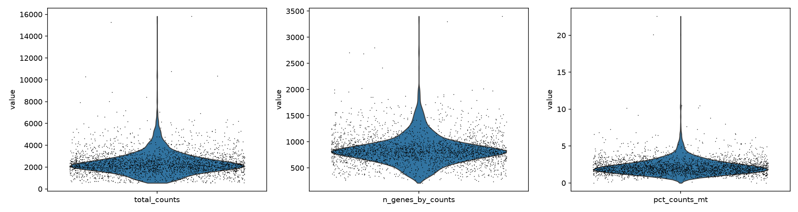
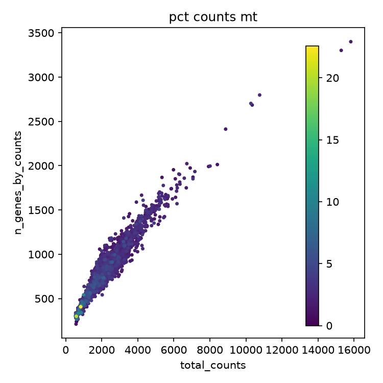

# Quality control — adaptive thresholds vs. the standard fixed cutoff

What `scripts/01_qc_filter.py` computes, and exactly how its output differs
from the fixed-threshold QC of the standard PBMC3k tutorial, on the same data.

**Data:** public 10x Genomics PBMC3k (2,700 cells). A droplet-based smoke test,
not Parse data — see the caveats.

---

## Method

Three per-cell metrics from scanpy's `calculate_qc_metrics`: total counts,
genes detected, and percent of counts from mitochondrial genes. Two hard
floors first — at least 200 genes per cell, at least 3 cells per gene — to drop
the most obviously empty barcodes before any statistics.

**Adaptive (MAD) outliers.** Each metric's acceptable range comes from the
dataset's own median and spread, following OSCA [3] and SCTK-QC [1]:

```
is_outlier(x) = x < median(x) − k·MAD(x)   or   x > median(x) + k·MAD(x)
MAD(x)        = median(|x − median(x)|)
```

applied to `log1p(total_counts)`, `log1p(genes detected)` and mitochondrial %,
with *k* = 5 by default (`--mad`; OSCA commonly uses 3–5). A hard 8%
mitochondrial ceiling (`--mt-ceiling`) is a backstop in case the adaptive bound
lands somewhere too permissive.

**Doublets.** Scrublet, independently of the outlier logic — a cell can look
normal by counts and still be flagged, or the reverse.

**Removed** if it fails *any* of: counts, genes, mitochondrial (adaptive or
ceiling), or doublet.

---

## Results on PBMC3k

Default settings (`--mad 5 --mt-ceiling 8`):

| Stage | Cells | Removed |
|---|---|---|
| loaded | 2,700 | — |
| after hard floors | 2,700 | 0 |
| QC outliers (counts 58, genes 80, mito 76 — overlapping) | — | 146 |
| predicted doublets | — | 32 |
| **final (union of both)** | **2,526** | **174** |



*Before filtering: a long right tail on all three metrics, and a small group
above ~10% mitochondrial — what the adaptive filter is meant to catch without a
hand-picked cutoff.*



*High-mitochondrial cells (yellow) sit mostly at low counts and genes —
consistent with stressed or dying cells rather than random noise.*

---

## Comparison with the standard fixed threshold

The most widely used convention for this dataset comes from Seurat's PBMC3k
tutorial [4]: keep cells with **200–2,500 genes** and **<5% mitochondrial**.

| Approach | Removed | Kept |
|---|---|---|
| fixed (genes < 2,500, mito < 5%) | 62 | 2,638 |
| adaptive (MAD) only, no doublet calling | 146 | 2,554 |
| **adaptive + Scrublet (this script)** | **174** | **2,526** |

| Overlap of fixed vs. MAD-only | Cells |
|---|---|
| removed by both | 62 |
| removed by fixed only | 0 |
| removed by MAD only | 84 |

> **Key result:** every cell the fixed method removes, the adaptive one removes
> too. On this dataset it is a strict superset, not a different answer.

Where the adaptive thresholds landed:

| Metric | Fixed | MAD (k=5), this dataset |
|---|---|---|
| genes per cell, ceiling | 2,500 | ~1,820 (stricter) |
| genes per cell, floor | 200 (hard floor only) | ~366 |
| mitochondrial %, ceiling | 5% | ~4.7% (+ 8% backstop) |
| counts per cell, floor | none | ~708 |
| counts per cell, ceiling | none | ~6,811 |

---

## Why they differ

1. **The fixed method has no lower bound.** Past the 200-gene floor it never
   looks for unusually *low*-complexity cells. MAD is symmetric, so it also
   catches the low tail — the whole source of the 84 extra cells.
2. **The fixed method has no doublet detection.** The tutorial predates routine
   computational doublet calling; Scrublet adds 32 cells it never looks at.

The adaptive gene ceiling (~1,820) also came out *stricter* than 2,500: MAD
follows this dataset's spread rather than a number chosen to suit many
datasets — exactly the trade-off OSCA argues for [3], and why a fixed number
right for one dataset can be wrong for another.

---

## Caveats

- **Not Parse data.** PBMC3k is droplet-based; split-pool doublet and ambient-RNA
  mechanisms differ ([design decisions](design-decisions.md#what-each-qc-metric-catches)).
  The thresholds and gaps here are specific to this dataset. On real Parse data
  see [real-data validation](real-data-validation.md).
- **"Standard" means one convention.** 200–2,500 genes / 5% mitochondrial is the
  most cited rule for this dataset, not a universal standard.

---

References: [1] Hong et al. 2022; [3] OSCA; [4] Hao et al. 2021 — full entries
in [design decisions](design-decisions.md#references).
Code: [`scripts/01_qc_filter.py`](../../scripts/01_qc_filter.py) ·
Next report: [Normalization, HVG, PCA](normalization-pca.md)
