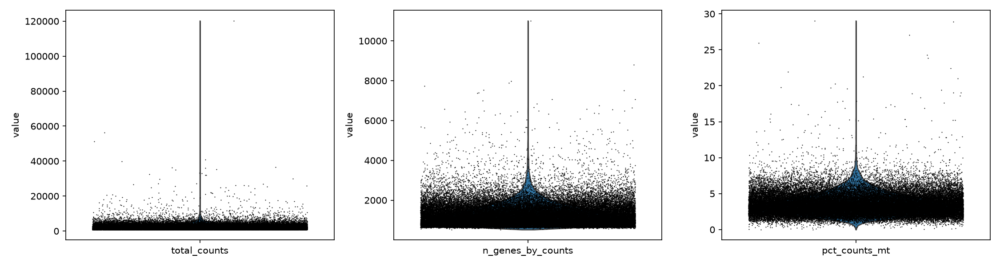
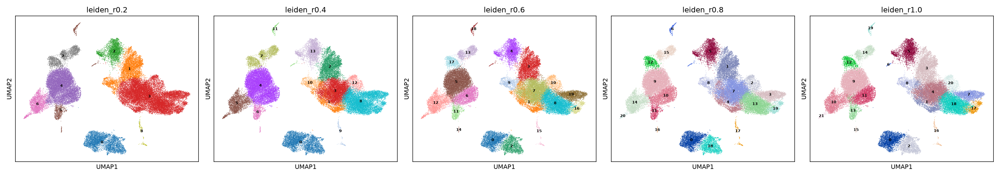
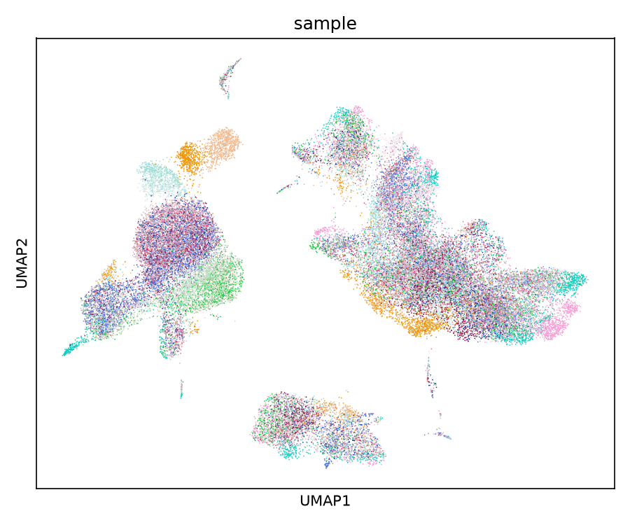
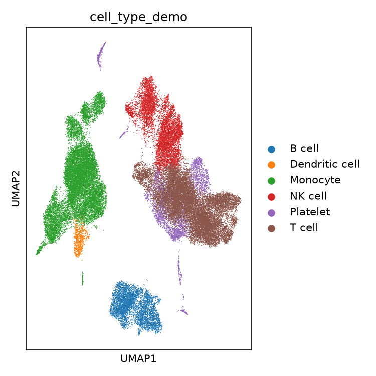

# Real-data validation — Parse's 1M-cell PBMC dataset

The PBMC3k reports used droplet data, one sample, an easy case. This report
runs the pipeline on real Parse Evercode split-pool data: first a 50,000-cell
subset, then the full dataset on the cluster. Several findings only appeared
at this scale.

**Data:** Parse Biosciences' public 1M PBMC (Type 1 diabetes) dataset, used in
Seurat's [sketch-integration tutorial](https://satijalab.org/seurat/articles/parsebio_sketch_integration):
987,585 cells × 60,664 genes, 24 donors (12 healthy, 12 Type 1 diabetes),
CC BY 4.0, [cdn.parsebiosciences.com/1M_PBMC_T1D_Parse.zip](https://cdn.parsebiosciences.com/1M_PBMC_T1D_Parse.zip).

---

## Full-scale results

Run on the cluster, raw files through CellChat:

| Stage | Result |
|---|---|
| 00 load | 987,585 cells × 60,664 genes, 24 donors |
| 01 QC (doublets per sample) | 907,696 cells kept (79,889 removed: 22,843 flagged as QC outliers and 57,172 as doublets; some cells were flagged as both) |
| 02 normalize / PCA | 2,000 highly variable genes → 50 components |
| 02b Harmony (batch = donor) | converged in 6 iterations across 24 batches |
| 03 cluster (on Harmony embedding) | 16 clusters at resolution 0.6 |
| 04b annotation | 12 of 16 clusters labelled confidently; 4 flagged `Ambiguous` rather than forced |
| 06 export | 694,803 confidently labelled cells, 10 cell types |
| 07 CellChat | 291 significant interactions, 19 pathways, ~1.5 h ([details](cellchat.md)) |

Real problems found and fixed on the way: doublet detection on all donors at
once ran out of memory at 400 GB (fixed: per sample); harmonypy 2.0.0
corrupted its output (fixed: pinned 0.0.10); CellChat with 8 workers ran out of
memory (fixed: 1 worker). Each is in [the troubleshooting page](../12-troubleshooting.md).

The rest of this report is the earlier 50,000-cell subset, which surfaced most
of the issues first.

---

## The 50,000-cell subset

Both entry points were tested: the direct `DGE_filtered` path and the
Trailmaker path (`Seurat::ReadParseBio()` → `.rds` → `00b` → `00`). Both gave an
identical 50,000 × 60,664 object.

### QC: one real bug found and fixed

About a third of genes (20,055 of 60,664) have an empty `gene_name` — a blank
CSV field. It crashed the original loader (and, separately,
`Seurat::ReadParseBio()`). Fixed by falling back to `gene_id` for those genes.

| Stage | Cells |
|---|---|
| loaded | 50,000 |
| after hard floors | 50,000 |
| QC outliers (counts 153, genes 102, mito 602) | −752 |
| predicted doublets | −2,626 |
| **final** | **46,754 (93.5%)** |

The doublet rate (5.25%) is higher than PBMC3k's (1.2%), as expected: split-pool
doublets scale with cells per sublibrary, and this run pools far more cells than
one 10x lane.

### Clustering: is it donors, or biology?

| Resolution | Clusters (real data) | Clusters (PBMC3k) |
|---|---|---|
| 0.2 | 9 | 3 |
| 0.4 | 14 | 4 |
| 0.6 | 20 | 6 |
| 0.8 | 21 | 5 |
| 1.0 | 22 | 7 |

With no batch correction yet, the obvious worry is that the extra clusters are
24 donors' technical variation. Checked directly at resolution 0.6:

| Metric | Value |
|---|---|
| ARI (clusters vs. donor) | 0.055 |
| NMI (clusters vs. donor) | 0.176 |
| clusters >80% from one donor | 1 of 20 |

> **Key result:** low agreement between clusters and donors — the extra
> clusters are mostly **not** a batch artefact. One cluster (95% one donor) is
> the exception: a donor-specific rare population or expanded clone, worth a
> manual look. The rest most likely reflects real biological richness in 24
> immune systems that one 2,700-cell sample does not contain.

| Clusters across resolutions | Same layout coloured by donor |
|---|---|
|  |  |

Low *global* agreement does not mean no batch effect — that one cluster shows it
locally — so batch correction (Harmony) was applied in the full run before any
healthy-vs-T1D comparison.

### Annotation at scale

The 5–6-category demo dictionary that worked on PBMC3k broke at 20 real
clusters. Several clusters were labelled **"Platelet"** with scores barely above
zero and negative everywhere else — for example one cluster scored T −0.003,
B −0.040, monocyte −0.242, NK −0.082, platelet −0.000, DC −0.008. "Platelet"
won only because it was the *least negative*.

This is why the pipeline now uses `04b_better_annotation.py`: a 12-category
dictionary, and a label only when the best score is clearly ahead of the
runner-up — otherwise `Ambiguous`. On the full run it labelled 12 of 16
clusters confidently and flagged 4 honestly.

---

References: [5] Rosenberg et al. 2018 ([design decisions](design-decisions.md#references));
the dataset above.
Previous: [Markers and annotation](annotation.md) · Next: [Cell-cell communication](cellchat.md)
